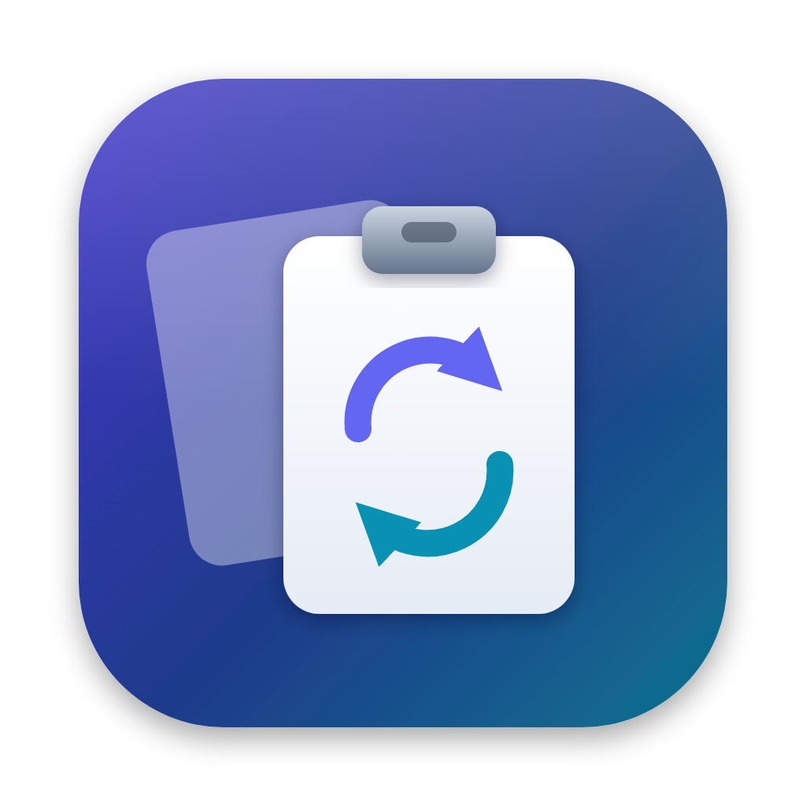

<p align="center"></p>

# ClipShare for Windows

**Share your clipboard between Windows and Linux.**

ClipShare is a small Windows tray app that syncs clipboard history with
[omaclip](https://github.com/rhemvi/omaclip), a clipboard manager for Linux. omaclip is built with
[Omarchy](https://omarchy.org) in mind but runs on most distributions (Arch, Debian/Ubuntu,
Fedora, openSUSE and others). Copy something on your Linux machine and paste it on Windows with
one shortcut, or the other way around.

Linux keeps running stock omaclip, unchanged. ClipShare for Windows speaks omaclip's sync protocol
(v2) directly, so any number of Windows PCs and Linux machines can share one clipboard.

Also on a Mac? [ClipShare for Mac](https://github.com/JoelCranston/Clipshare_Mac) is a separate
app that speaks the same protocol, so it can join the same clipboard too.

## Features

- **Tray only.** No taskbar button and no window until you ask for one. The tray icon dims when no
  peer is connected, its tooltip names the connected peers, and its right-click menu shows each
  peer's status. Left-click the icon to open the history panel.
- **History panel (Win+Alt+V by default).** A floating panel with everything copied on this PC and
  on your Linux machines. Type to search; use ↑/↓ and Enter, Ctrl+1–9 for quick picks, and Tab to
  switch between All / This PC / Peers. Choosing an entry copies it and (optionally) pastes it into
  the app you were using.
- **Paste latest from Linux (Win+Ctrl+Alt+V by default).** Pastes the newest entry from any peer
  straight into the front app.
- **Auto-Copy from Peers.** An optional menu toggle that puts every new Linux copy onto the Windows
  clipboard as soon as it arrives.
- **Two-way.** The PC shares its newest copies (5 by default) back to omaclip, so they show up in
  omaclip's remote clipboard list on Linux.
- **Text and images,** including image files copied in File Explorer (sent as the image itself, not
  its name). Line endings are converted, so text copied on Windows pastes cleanly on Linux and back.
- **Private by default.** It skips items that password managers ask clipboard tools to ignore
  (`ExcludeClipboardContentFromMonitorProcessing`, or excluded from Windows clipboard history),
  keeps history in memory only, and stores the passphrase in Windows Credential Manager.
- **Customizable, layout-aware shortcuts.** Change either shortcut in Settings › Shortcuts.
  Letter shortcuts and the automatic paste follow your active keyboard layout (Dvorak, AZERTY, …):
  Win+Alt+V means the key that types "v", wherever it sits.

The defaults sit next to Windows' own clipboard history (Win+V), which ClipShare leaves alone.

## Requirements

- Windows 10 version 1809 or newer, or Windows 11 (x64 or ARM64)
- omaclip v0.10 or newer (sync protocol v2) on your Linux machines
- To build: the [.NET 10 SDK](https://dotnet.microsoft.com/download/dotnet/10.0)

## Install

Download the latest `ClipShare-<version>-win-x64.exe` (or `-win-arm64.exe` for ARM PCs) from
[Releases](https://github.com/JoelCranston/Clipshare_Windows/releases), and put it somewhere it can
stay, such as `%LOCALAPPDATA%\Programs\ClipShare\ClipShare.exe`, before turning on Launch at login.
Every CI run also builds one (the `ClipShare-win-x64` and `ClipShare-win-arm64` artifacts on the
run's summary page). Or build it yourself in PowerShell:

```powershell
git clone https://github.com/JoelCranston/Clipshare_Windows.git
cd Clipshare_Windows
./scripts/publish.ps1 -Install   # builds, copies to %LOCALAPPDATA%\Programs\ClipShare, adds a Start menu entry, and starts it
```

`./scripts/publish.ps1` on its own just builds `publish\win-x64\ClipShare.exe`, a single
self-contained file that doesn't need .NET installed.

ClipShare isn't code-signed, so the first time you run a downloaded copy Windows SmartScreen may
warn about it; choose **More info › Run anyway**.

## Setup

1. On first launch, Settings opens. Enter the **same passphrase** you use for omaclip. If omaclip
   was ever set up on this PC, ClipShare imports it from `%USERPROFILE%\.config\omaclip\config.json`
   automatically.
2. When Windows Defender Firewall asks, allow ClipShare on **private networks**, so it can find
   omaclip and omaclip can reach the PC. (If you dismissed the prompt, allow `ClipShare.exe` in
   Windows Security › Firewall & network protection › Allow an app through firewall.) Your network
   should be set to *Private* in Settings › Network & internet for discovery to work.
3. Optionally turn on **Launch at login** in Settings › Behavior.

Automatic pasting needs no permission on Windows. The one exception: Windows doesn't let a normal
app type into apps running as administrator, so pasting into an elevated window only copies.

### Same network

Nothing else to do. ClipShare and omaclip find each other with mDNS (`_omaclip._tcp`).

### Tailscale or other VPNs

mDNS usually doesn't cross VPNs, so give each side a fixed port and point them at each other:

```bash
# On Linux
omaclip --sync-server-port=36742 --peers-list=windows@100.64.0.4:36742
```

In ClipShare's Settings › Network, set the port to `36742` and the manual peers to
`omarchy@omarchy.local:36742` (or `omarchy@100.64.0.3:36742`), then click **Apply Network
Settings**. Settings lists this PC's addresses and port so you can copy them into the omaclip
command. Remember to allow the port through the firewall for the network Tailscale uses.

ClipShare's manual peers can use host names as well as IP addresses, for example
`omarchy@omarchy.local:36742` or a Tailscale MagicDNS name like `omarchy.tail1234.ts.net:36742`.
They're resolved to IPv4 every 30 seconds, so a peer whose address changes keeps working.
omaclip's own `--peers-list` on Linux only accepts IP addresses.

## How it works

Every peer runs a small HTTPS server, and peers poll each other every 2 seconds:

1. `GET /api/clipboard/checksum`: stop here if nothing changed.
2. `GET /api/clipboard`: a newest-first manifest (`id`, `checksum`, `contentType`,
   `imageMimeType`, `timestamp`) without payloads, whose own checksum is verified.
3. `GET /api/clipboard/{id}/content`: only for payloads not already held, each verified against
   its SHA-256.

Security comes entirely from the shared passphrase:

- Argon2id(passphrase, salt = passphrase reversed, t=1, m=64 MiB, p=4) gives a 32-byte key. Its hex
  goes in the `X-Omaclip-Pass` header of every request, and its first 16 hex characters are
  advertised in the mDNS TXT record (`ph=`) so peers with other passphrases ignore each other.
- HKDF-SHA256(key, salt `omaclip-ca-v1`) derives the same P-256 CA key on every machine. Each peer
  signs a fresh leaf certificate for its IPv4 addresses with it, and peers trust only certificates
  from that CA.

ClipShare does its own multicast DNS (advertising and browsing on UDP 5353 next to Windows' built-in
responder) so it sends exactly the records omaclip's responder expects, on every Windows version.

## Development

```bash
dotnet test tests/OmaclipCore.Tests     # works on Windows, Linux and macOS
tests/interop/run.sh                    # Linux/macOS with Go: checks against omaclip's own code
dotnet build src/ClipShare              # the app builds anywhere; it runs on Windows
```

The unit tests check ClipShare against values generated with omaclip's Go code paths (Argon2 key, CA
key, manifest JSON and checksum, JSON escaping), run a real HTTPS server ↔ client round trip, and
have two mDNS instances find each other. The interop script builds a small peer out of omaclip's
unchanged Go packages (sync server, fetcher, mDNS discovery) and syncs with ClipShare's protocol
stack in both directions. CI runs the unit tests on Windows and Linux, the interop script, and
builds `ClipShare.exe` for x64 and ARM64.

| Path | What's there |
| --- | --- |
| `src/OmaclipCore` | Protocol, crypto, HTTPS server, peer client, mDNS (cross-platform .NET) |
| `src/ClipShare` | The Windows Forms tray app |
| `tests/OmaclipCore.Tests` | Unit tests |
| `tests/interop` | Interop check against omaclip's Go code |
| `assets` | App icon: SVG source, 1024px render, and the `.ico` used by the app |
| `scripts/publish.ps1` | Builds (and optionally installs) the single-file `ClipShare.exe` |

## Releasing

Bump `<Version>` in `src/ClipShare/ClipShare.csproj`, then either run the **Release** workflow
from the Actions tab with that version, or push a tag such as `v1.0.1`. It runs the tests, builds
both architectures, smoke-tests the x64 build and publishes a GitHub release with both `.exe`
files and their SHA-256 sums.

## Related projects

- [omaclip](https://github.com/rhemvi/omaclip): the Linux clipboard manager whose sync protocol
  ClipShare speaks.
- [ClipShare for Mac](https://github.com/JoelCranston/Clipshare_Mac): the native macOS menu bar
  app, which this Windows client is built to match.

## Acknowledgements

ClipShare is an independent client for [omaclip](https://github.com/rhemvi/omaclip) by Athanasios
Ntavelis.

## License

ClipShare is released under the [MIT License](LICENSE). It uses
[Konscious.Security.Cryptography.Argon2](https://github.com/kmaragon/Konscious.Security.Cryptography)
(MIT) for Argon2id.
